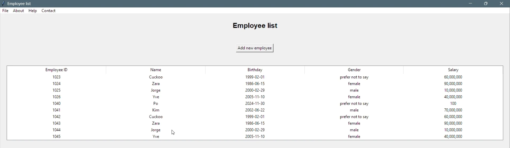

# Employee Management System

A desktop app for managing employee and user records, built with Python, Tkinter and SQL Server. Users log in, then add, edit, delete and import employees, manage other users, and contact the administrator by email.



[Watch the demo video](https://drive.google.com/file/d/1fkokFHrqTdgTMEzrMHlbeEjTgF8W-uUi/view) (about a minute).

## Features

- **Login** with passwords hashed using bcrypt.
- **Employees:** view the list, add and edit employees with a date picker for birthdays, and right-click to edit or delete. You can select several employees and delete them at once.
- **Import:** add employees in bulk from an Excel spreadsheet. [`employee_sample_list.xlsx`](employee_sample_list.xlsx) shows the expected columns.
- **Users:** view, add, edit and delete users. New passwords need at least 8 characters, with uppercase, lowercase, a number and a special character.
- **Contact:** send a message to the administrator by email through Gmail.

## Tech stack

- Python 3.12 and Tkinter, with tkcalendar for the date picker
- SQL Server through pyodbc
- pandas and openpyxl for the Excel import
- bcrypt for password hashing

## Run it locally

### Prerequisites

- Python 3.12
- SQL Server and an ODBC driver for it
- A Gmail account with an [app password](https://support.google.com/accounts/answer/185833), only needed for the contact form

### Steps

1. Install the dependencies:

   ```sh
   pip install -r requirements.txt
   ```

2. Create a database in SQL Server and run [`DB_Schema_Script.sql`](DB_Schema_Script.sql) against it to create the tables.
3. Copy `.env.example` to `.env` and fill in your database and email details.
4. Add a first user, since you need to log in before you can create users in the app. Generate a password hash:

   ```sh
   python -c "import bcrypt; print(bcrypt.hashpw(b'YourPassword1!', bcrypt.gensalt()).decode())"
   ```

   Then insert the user in SQL Server, pasting in the hash:

   ```sql
   INSERT INTO dbo.users (username, password, name) VALUES (N'admin', N'<hash>', N'Admin');
   ```

5. Start the app:

   ```sh
   python main.py
   ```

## Known gaps

- Database queries are built with string formatting rather than parameters, so they're open to SQL injection.
- The **New Office**, **New Branch** and **Open** menu items are placeholders.
- There are no automated tests.
